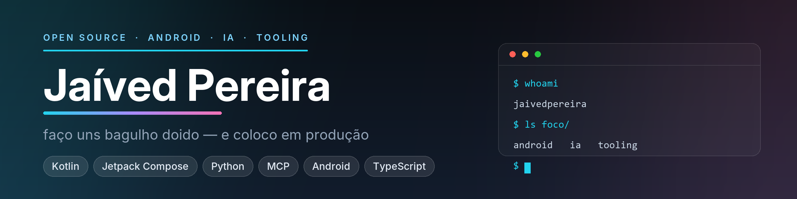

<picture>
  <source media="(prefers-color-scheme: dark)" srcset="assets/banner-dark.png">
  <source media="(prefers-color-scheme: light)" srcset="assets/banner-light.png">
  
</picture>

Sou o **Jaíved**. Construo ferramentas que eu uso todo dia — e depois abro o código.

Um editor de fotos Android que não pede assinatura. Agentes de IA com arquitetura
de plugins. Um leitor de mangá, um emulador de GBA, um baixador de música.
Quase tudo roda **local**: sem conta, sem nuvem, sem cobrança recorrente.

## 🔦 Em destaque

**[flow](https://github.com/jaivedpereira/flow)** · `★ 8`
Editor de fotos para Android com LUTs 3D de verdade (269 cubos), 13 efeitos estilo
GrainRad, HSL seletivo, curvas de tom, máscaras, texto e stickers, export em lote.
Sem conta, sem nuvem, sem assinatura.
`Kotlin` · `Jetpack Compose` · `Android`

**[Shark-Harness](https://github.com/jaivedpereira/Shark-Harness)**
Agente de tarefas com arquitetura tudo-é-plugin: shell, arquivos, código,
agendamento, controle do dispositivo, interface web, servidor MCP e CLI.
Zero dependências obrigatórias.
`Python` · `MCP` · `CLI`

**[hermit-purple](https://github.com/jaivedpereira/hermit-purple)**
Servidor MCP + bot de Telegram + CLI com 16 ferramentas (mangá, código, clima, JoJo).
`Python` · `Telegram` · `MCP`

**[Manganana](https://github.com/jaivedpereira/Manganana)** · [site](https://manganana.vercel.app)
Leitor de mangá na web, com índice de capítulos BR gerado por scraper direto do celular.
`JavaScript` · `Vue` · `Vercel`

## 🧪 Outros laboratórios

| Projeto | O que é | Stack |
| --- | --- | --- |
| **[horizon_cli](https://github.com/jaivedpereira/horizon_cli)** | Baixador de música por linha de comando | `JavaScript` |
| **[Duckgba](https://github.com/jaivedpereira/Duckgba)** | Emulador de Game Boy Advance | `Java` |
| **[botscan](https://github.com/jaivedpereira/botscan)** | Scanner de bots em curtidas do Instagram (CLI single-file) | `Python` |
| **[HorizonMusic_](https://github.com/jaivedpereira/HorizonMusic_)** | Player de música Android | `Kotlin` |
| **[OgRpg_v1](https://github.com/jaivedpereira/OgRpg_v1)** | [RPG de mesa](https://og-rpg-v1.vercel.app) jogável no navegador | `HTML` · `JS` |
| **[CrabAggregator](https://github.com/jaivedpereira/CrabAggregator)** | Agregador de conteúdo | `TypeScript` |

## 🧭 Como eu construo

- **Local primeiro.** Se funciona offline, não precisa de servidor meu.
- **Menos dependência, menos coisa pra quebrar.** O que dá pra fazer sem biblioteca, eu faço sem.
- **Se eu uso todo dia, eu mantenho.** É por isso que esses projetos continuam vivos.
- **Abre o código.** O que eu aprendi construindo também serve pra quem for construir depois.

## 🛠 Stack

## 📬 Onde me achar

[**GitHub**](https://github.com/jaivedpereira) ·
[**Manganana**](https://manganana.vercel.app) ·
[**OgRpg**](https://og-rpg-v1.vercel.app)

Aberto a conversa sobre Android, IA local e ferramentas de linha de comando.
