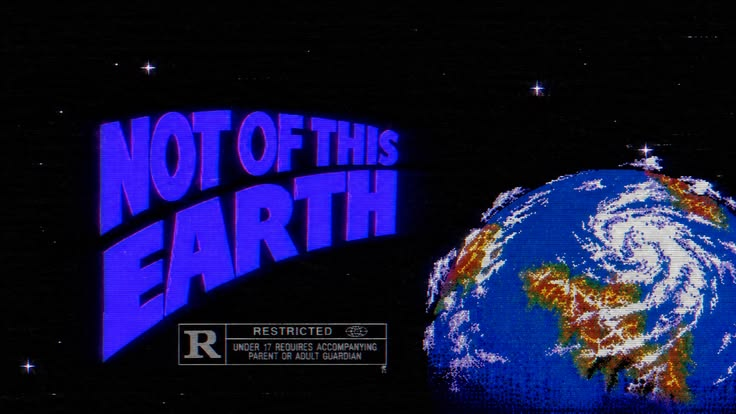

<h1 align="center">Jaíved Pereira</h1>

  Ferramentas <b>locais</b> que eu uso todo dia: Android, IA e tooling. 
  Sem conta, sem nuvem, sem assinatura.

 

### Em destaque

- **[flow](https://github.com/jaivedpereira/flow)** — editor de fotos Android com 269 LUTs 3D, curvas de tom e máscaras. `Kotlin` `Compose`
- **[Shark-Harness](https://github.com/jaivedpereira/Shark-Harness)** — agente de IA com arquitetura tudo-é-plugin, servidor MCP e CLI. `Python`
- **[Manganana](https://github.com/jaivedpereira/Manganana)** — leitor de mangá na web, no ar em [manganana.vercel.app](https://manganana.vercel.app). `Vue`

 

### Já trabalhei com

  

 

  
  
  

